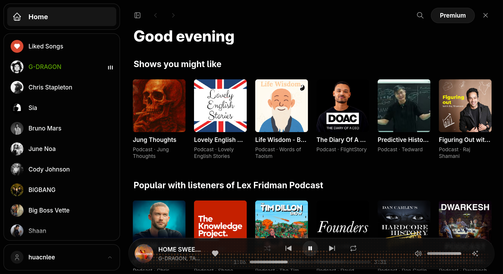

# Spotish

**An unofficial, native client for Spotify, built with [NSH](https://nsh.dev).**



**If this helps you, please [sponsor me](https://github.com/sponsors/huacnlee).**

Spotish is a lightweight, native desktop app that works with your Spotify account. Instead of running Spotify's web
app in a full browser window, it runs Spotify's own web player out of sight in a browser you already have installed,
and drives it from a fast, native interface drawn by NSH. Your Spotify account, free or Premium, does the playing, so
the catalogue, your library and Spotify's ads all work exactly as Spotify intends.

> **Unofficial — not affiliated with, endorsed by or sponsored by Spotify.** Spotify is a trademark of Spotify AB.
> All music and artwork belong to their rights holders. A Spotify account is required, and your use of Spotify
> through this app is subject to [Spotify's Terms of Use](https://www.spotify.com/legal/end-user-agreement/).
>
> **Spotish never blocks or skips Spotify's ads.** [Spotify Premium](https://www.spotify.com/premium/) is how you
> remove them, play any track on demand, and support the artists you listen to.

## Install

### Stable

**macOS / Linux** — run in Terminal:

```sh
curl -fsSL https://huacnlee.github.io/spotish/install.sh | bash
```

**Windows** — run in PowerShell:

```powershell
irm https://huacnlee.github.io/spotish/install.ps1 | iex
```

The installer downloads the latest release and verifies its checksum. Run the same command to update.
You can also [download a release](https://github.com/huacnlee/spotish/releases/latest) manually.

Supported builds: Apple silicon with macOS 14 or later, x86_64 Linux with GTK 4.14 and glibc 2.39 or later
(such as Ubuntu 24.04), and x86_64 Windows. Playback requires a [supported browser and a Spotify account](#requirements).
On macOS, the app is not notarized; the first launch may need approval in **System Settings → Privacy & Security**.

### Nightly

Spotish has no nightly channel yet. Every build is a tagged [release](https://github.com/huacnlee/spotish/releases);
to run the latest unreleased code, build from source.

### From source

Install Rust through [rustup](https://rustup.rs) and the `nsh` CLI 0.5.0, the version the app's crates are pinned to.
On Linux, also install the GTK 4.14+ development packages listed in NSH's
[installation guide](https://nsh.dev/docs/installation.md). Then clone the repository and run it:

```sh
curl -fsSL https://nsh.dev/install.sh | NSH_VERSION=v0.5.0 sh
git clone https://github.com/huacnlee/spotish.git
cd spotish
nsh run
```

On Windows, install the CLI in PowerShell instead:

```powershell
$env:NSH_VERSION="v0.5.0"; irm https://nsh.dev/install.ps1 | iex
```

See [CONTRIBUTING.md](CONTRIBUTING.md#setup) for details.

## What is NSH?

[NSH (Native Shell)](https://nsh.dev) is a Rust UI framework that renders one app through each platform's own native
views — on macOS, Windows, Linux, iOS, Android, the web and even the terminal. Spotish is an experiment that proves
out NSH's cross-platform ability on a real, non-trivial app: one Rust engine and one TSX interface, drawn natively, not
in a web page.

## Platforms

| Platform | Status |
| --- | --- |
| Linux, macOS | Plays music |
| Windows | Plays music through Microsoft Edge |
| Terminal (TUI) | Plays music, through the same engine as the desktop |
| Web, iOS, Android | Demo with sample data; a remote control for your desktop Spotish is planned |

Spotify's free tier plays only in Spotify's web player, with DRM (Widevine), in a real desktop browser. Web pages and
mobile apps cannot start that browser, and Spotify's mobile and web SDKs are for Premium only — so on those platforms
Spotish is a demo.

## Requirements

- An installed **Google Chrome, Chromium, Microsoft Edge or Brave**. Widevine, the DRM module that decodes Spotify's
  audio, cannot be bundled with Spotish; it comes with your browser (Chromium downloads it on first run). Set
  `SPOTISH_BROWSER` to the browser's executable to choose one.
- A **Spotify account** (free or Premium).

## How it works

- The **engine** (`src/spotify/`, Rust) starts your browser without a window, loads Spotify's web player, and drives it
  over the Chrome DevTools Protocol.
- A small **bridge** (`src/bridge/bridge.js`) runs inside the web player. It reads what the player itself uses to talk
  to Spotify, so the app can show the same data, reports the player's state, and presses its controls.
- The **interface** (TSX, from `App.tsx`) is native NSH: a sidebar workspace that adapts from a desktop layout to a
  phone layout, a player bar, a full-screen Now Playing view, library, search and collection pages.

See [CONTRIBUTING.md](CONTRIBUTING.md) for the layout of the code.

## Build and run

You need the `nsh` CLI 0.5.0 and Rust; see [From source](#from-source). `nsh run` builds the Rust engine, bundles
the TSX interface and runs it on this machine. `nsh check` runs `cargo check` and `tsc`, `nsh test` runs the Rust and
TSX tests, and `nsh build` describes the crate and bundles the interface.

```sh
nsh run
nsh check
nsh test
nsh build
```

`SPOTISH_DEMO=1 nsh run` runs on recorded sample data, with no browser and no account.

On first launch, press **Log in** and sign in to Spotify in the window that opens (with your Spotify account, or
Google, Apple or Facebook). Spotish keeps the login in its own browser profile across restarts. To reuse a browser you
are already signed in to, set `SPOTISH_PROFILE` to that browser's profile directory (for example `~/.config/chromium`);
close that browser while Spotish runs.

## Playback on Spotify Free

Spotify Free can shuffle-play playlists, albums and artists but cannot play a chosen track on demand, so tapping a
song shuffles its playlist, as Spotify's web player does. Ads play as Spotify serves them. **Premium** plays any track
on demand and has no ads.

## Benchmarks

### Memory

Measured on Linux (Chromium, x86_64) with music playing, summing the app's whole process tree. PSS splits pages shared
between processes among them, so it is the real footprint; RSS counts every shared page once per process, which is
why a system monitor that adds up RSS shows 600–800 MB.

| Part | PSS | RSS |
| --- | ---: | ---: |
| Spotish itself (NSH, the Rust engine, the TSX interface) | 77 MB | 95 MB |
| Spotify's web player page (Chromium renderer) | 219 MB | 294 MB |
| Other Chromium renderers (service worker, frames) | 32 MB | 207 MB |
| Chromium's browser, GPU, network, audio, storage and CDM processes | 52 MB | 210 MB |
| **Total** | **381 MB** | **806 MB** |

Most of the memory belongs to the headless browser that plays Spotify, mainly the web player's own JavaScript and
page. The native interface stays under 100 MB.

_TODO: startup and frame numbers._

## License

[Apache-2.0](LICENSE-APACHE). As a special grant, **Spotify AB may use this project freely, with no conditions and no
attribution required** — see [NOTICE.md](NOTICE.md).
